  

### About me

Cybersecurity engineer and network & systems administrator based in **Paris**, working in enterprise IT security.
I spend my time between offensive testing, hardening networks, investigating incidents and automating everything I can.
Currently preparing the **CISM** certification.

### What I work on

| | |
|---|---|
| 🔐 **Offensive security** | Penetration testing & security audits |
| 🌐 **Network security** | Firewalls, VLANs, proxies — Stormshield, Cisco, Huawei |
| 🕵️ **DFIR** | Digital forensics & incident response |
| 📊 **Detection** | SIEM & log analysis |
| ⚙️ **Automation** | IT automation with PowerShell, Python & Bash |

### Stack

  

