  

  Cybersecurity engineer and network &amp; systems administrator based in <b>Marseille</b>, working in enterprise IT security. 
  I spend my time between offensive testing, hardening networks, investigating incidents and automating everything I can.

 

  

  

 

  <picture>
    <source media="(prefers-color-scheme: dark)" srcset="https://raw.githubusercontent.com/NicolasBoivin/NicolasBoivin/output/snake-dark.svg">
    <source media="(prefers-color-scheme: light)" srcset="https://raw.githubusercontent.com/NicolasBoivin/NicolasBoivin/output/snake-light.svg">
    
  </picture>

